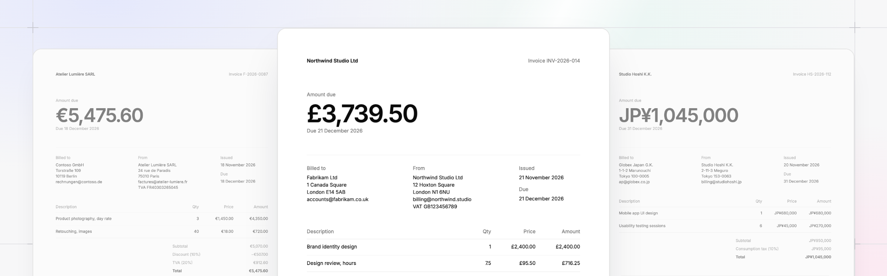

# create-beautiful-invoices-mcp

> 💸 An MCP server that creates beautiful, real PDF invoices. Ask your AI assistant for an invoice and get a PDF on disk.

[Example](.github/assets/example-invoice.pdf), the one in front above.

## 🎠 Just want to use?

Nothing to install: connect to `https://www.nothing-fancy.space/invoice/api/mcp`.

```bash
claude mcp add --transport http invoices https://www.nothing-fancy.space/invoice/api/mcp
```

## ⚡ Or host and have your own?

You need Node 24.

Claude Code:

```bash
claude mcp add invoices -- npx -y create-beautiful-invoices-mcp
```

Claude Desktop, Cursor and other clients take the same command in their MCP config:

```json
{
  "mcpServers": {
    "invoices": {
      "command": "npx",
      "args": ["-y", "create-beautiful-invoices-mcp"],
      "env": { "INVOICES_DIR": "/Users/you/Invoices" }
    }
  }
}
```

Then ask: _"Invoice Fabrikam for 7.5 hours of design review at £95.50 an hour, with 20% VAT, due in 30 days."_

## 🛠️ Tools

### `create_invoice`

Renders the invoice to a PDF, saves it to the invoices folder and returns its path with a link to the file. An invoice number that already has a PDF gets a numbered copy, such as `invoice-INV-001 (2).pdf`, so no invoice is ever replaced.

| Field                  | Description                                                                                                       |
| ---------------------- | ----------------------------------------------------------------------------------------------------------------- |
| `invoiceNumber`        | Unique number, also the payment reference                                                                         |
| `issueDate`, `dueDate` | `YYYY-MM-DD`. Today and 30 days later by default. The due date can't be before the issue date                     |
| `currency`             | `GBP`, `EUR`, `USD`, `AUD`, `BRL`, `CAD`, `CHF`, `CNY`, `INR`, `JPY`, `KRW`, `NZD`, `RUB`, `SGD` or `ZAR`         |
| `seller`               | `name`, and optionally `address`, `email`, `phone`, `taxNumber` and `logo`, an absolute path to a PNG or JPEG     |
| `client`               | `name`, and optionally `address` and `email`                                                                      |
| `items`                | At least one `{ description, quantity, unitPrice }`. `quantity` defaults to 1                                     |
| `discountRate`         | Discount on the subtotal in percent, taken off before tax                                                         |
| `taxRate`, `taxLabel`  | Tax in percent and its name, `VAT` by default. Without a rate, the invoice has no tax                             |
| `notes`                | Text under the totals, such as a PO number or a thank-you                                                         |
| `payment`              | `uk-bank-transfer` with a sort code and account number, or `iban-transfer` with an IBAN and an optional SWIFT/BIC |

## ⚙️ Configuration

| Variable           | Default      | Description                                         |
| ------------------ | ------------ | --------------------------------------------------- |
| `INVOICES_DIR`     | `~/Invoices` | Folder the PDFs are saved to                        |
| `INVOICE_DEFAULTS` |              | JSON file with the fields every invoice starts from |

### Saved defaults

Save what repeats in a JSON file and point `INVOICE_DEFAULTS` at it. The tool then asks only for the rest, such as the client and the items:

```json
{
  "seller": {
    "name": "Northwind Studio Ltd",
    "address": "12 Hoxton Square\nLondon N1 6NU",
    "email": "billing@northwind.studio",
    "taxNumber": "GB123456789",
    "logo": "/Users/you/Invoices/logo.png"
  },
  "payment": {
    "method": "uk-bank-transfer",
    "accountName": "Northwind Studio Ltd",
    "sortCode": "20-00-00",
    "accountNumber": "55779911"
  },
  "currency": "GBP",
  "taxRate": 20,
  "dueInDays": 14
}
```

The file can set `seller`, `payment`, `currency`, `taxRate`, `taxLabel`, `notes` and `dueInDays`. A field given in a call replaces its default as a whole. The server doesn't start with a file it can't read, so a typo never turns into a wrong invoice.

## 🧑‍💻 Development

pnpm 12 and Node 24. See [AGENTS.md](AGENTS.md) for the layout and rules.

```bash
pnpm install
pnpm validate   # format check, lint, typecheck and tests
pnpm inspect    # the server from source in the MCP Inspector
pnpm build      # packages/mcp-server/dist/main.js
```

## 📄 License

[MIT](LICENSE)
